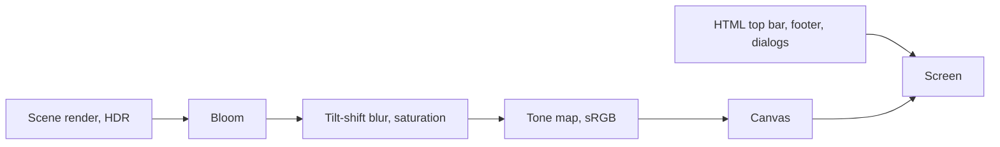

# Vampire Simulator: 3D version spec

The 3D version is the same game with a new renderer. The rules, tuning, map generator, and pathfinding in the 2D prototype stay as they are. This spec covers what is drawn and how.

## 1. Decisions

| Topic | Decision |
| --- | --- |
| Engine | Three.js on WebGL2, loaded as ES modules. No game framework on top. |
| Glow | HDR render, emissive materials brighter than 1.0, one bloom pass with a threshold of 1.0. |
| Tilt-shift | A screen-space blur pass that grows toward the top and bottom of the view. |
| HUD and info bar | HTML elements laid over the canvas. Never part of the 3D scene, never blurred. |
| Simulation | Unchanged 2D simulation. Height is visual only. |
| View | Three-quarter top-down: the camera looks almost straight down, tilted 25 degrees off vertical. |
| World edge | Never in view. The ground carries on past the town, farther than the camera can see. Characters stay inside the town. |
| Home decay | One model, two texture sets, blended in the shader by a decay value. |
| Bridge | A kit of fixed-length pieces placed by code. No piece is ever stretched. |
| Models | glTF binary (`.glb`), one file per asset. |

Why Three.js: it has the three things this game depends on as stock parts (emissive materials, a bloom pass, an effect chain for the tilt-shift pass), it loads glTF, and it runs from plain module files, so the project keeps its no-bundler setup. Babylon.js would also work, and its glow layer is simpler to switch on, but it is a much larger download for a scene this small.

## 2. Architecture

Split `index.html` into a simulation and a renderer. The simulation knows nothing about drawing.

- `sim.js`: everything from `TUNE` through `update()`, including `layout()`, the door cost maps, and `cameraSubject()`. It exposes the state the renderer reads: `houses`, `actors`, `player`, `crypt`, `tombs`, `river`, `roads`, `bridges`, `clock`, `rally`, `logs`.
- `render3d.js`: builds the scene once per map, then each frame copies positions and states out of the simulation.
- `render2d.js`: the current canvas drawing, kept behind `?view=2d` as a debug view. It is the fastest way to tell a rules bug from a drawing bug.
- `ui.js`: the top bar, the two-line footer, the doorstep conversation, the death banner, and the title and end screens, all as HTML.

Coordinates: 1 tile (32 simulation pixels) is 3 metres, so the map is 156 by 84 metres. A simulation point `(x, y)` maps to world `(x * 3 / 32, heightAt(x, y), y * 3 / 32)`. Walkers, collisions, and travel times stay flat. Only the renderer calls `heightAt`.

The `make build` check must change: it parses the one inline script today and needs to parse each module file instead.

## 3. Terrain

One heightfield mesh covers the map, with a vertex every 0.75 metres (four per tile, about 23,000 vertices). `heightAt(x, y)` is a pure function of the generated map, the sum of these parts:

| Feature | Shape |
| --- | --- |
| Ground | Slow noise, 0.15 m high, 20 m across, so the grass is not a flat sheet. |
| River | A trough along the river line. The bed is 1.2 m down at the centre and rises to ground level over the last 3 m before each bank. The banks stay where the simulation puts them (74 pixels from the centre line). |
| Roads | Sunk 0.05 m, with noise 0.08 m high and 2 m across for lumps, and two shallow wheel ruts. No lumps on the last 2 m before a bridge. |
| Church hill | 2 m high. Flat for 6 m around the church, then falling to ground level 20 m out along a smooth curve. The steepest point is about 12 degrees. |
| Building pads | The ground under every building, and the tile at its door, is level. |

Water is a flat, slightly see-through plane 0.5 m below ground level, drawn only inside the trough.

The ground uses one material that blends four tiling textures (grass, dirt road, river bed, graveyard turf) by weights worked out from the same distances the height function uses. Weights are stored per vertex.

### Beyond the town

The game must never look cut off. The town is the 156 by 84 metre area the simulation uses, and the ground carries on past it on every side, farther than the camera can ever see. The camera looks steeply down, so no horizon or sky is ever in frame and neither is built.

- **Outskirts mesh:** a second, coarser heightfield (a vertex every 3 m) surrounds the town mesh for 150 m on every side. That is more than twice the most ground the camera can show past the town's edge. It shares the town mesh's edge vertices so there is no seam, and it uses the same `heightAt` function and the same ground material.
- **Roads and river continue:** both are endless straight lines in the generator, so the road surface and the river trough run on across the outskirts and off the edge of the view. Nothing stops at the town's edge.
- **Dressing:** trees, hedges, and field patches are scattered across the outskirts from the map seed, as instanced low-detail models. They never stand on a road or in the river.
- **Guard:** the camera's tilt and field of view are limited in code so that the outskirts always fill the frame. If either `TUNE` value is raised far enough to show the rim, the margin grows to match.

The player and every hunter and vampire stay inside the town. The simulation already enforces this, since the tile grid ends at the map's edge, and that does not change. The 3D scene has to make the limit read as part of the place and not as an invisible wall:

- A low drystone wall runs along the town's boundary.
- Each road leaves through a shut gate in the wall.
- The river passes under the wall through a low arch. Nobody can enter the water anyway.

The wall is low enough that the camera always sees over it to the outskirts.

Two changes to the map generator support the hill:

- The house of worship must sit at least 20 m plus the river's half-width from the river line, so the hill never spills into the water.
- No home may be placed within 20 m of the house of worship, so no home sits on the slope. Roads may cross the hill and follow its surface.

## 4. Homes

All 16 homes share one model and one UV layout. Variety comes from a roof tint and wall tint per home, drawn from the map seed. Every home faces south, as in the simulation (see the open questions).

Decay never changes the model. Each home's material has:

| Texture | Purpose |
| --- | --- |
| Clean colour | Walls, roof, trim as built. |
| Decayed colour | The same surfaces rotted: dark roof, grey walls, stains, moss. |
| Decay mask | Greyscale. Dark areas rot first (roof edges, the base of the walls), light areas last. |
| Normal | Shared by both states. |
| Window mask | White where the window panes are, black elsewhere. Drives emission. |

The shader takes a `decay` value from 0 to 1 per home and shows decayed colour wherever `decay` is above the mask, with a soft edge. Rot then creeps across the house over the nights, which a plain cross-fade cannot do. The value comes from the rule the 2D game uses now: 0 for a clean home, 0.4 on the night it is cursed, rising to 1.0 at `nightsToSpawnVampire`, and 1.0 whenever a vampire lives there. The renderer eases toward the target over a few seconds so a purge or a curse reads as a change, not a cut.

The house of worship and the crypt are separate models with a single texture set each. When the house of worship falls at the end of the game, it switches to the decayed look by the same shader, so it needs a decayed colour texture and mask too.

Parts that must be separate nodes in the model file, because code moves them:

- The door, pivoted on its hinge edge. Shut on living households and the crypt, open on an empty cursed home.
- The cross on the house of worship, with its own material.
- The window panes do not need to be separate. The window mask handles them.

Textures are 1024 pixels square for buildings and 512 for tiling ground textures.

## 5. Glow

Everything that glows is an emissive surface, and one bloom pass turns brightness into glow.

- Render to a half-float target so colours can go above 1.0.
- Lit surfaces stay below 1.0. Emitters are set between 2 and 8.
- The bloom pass has a threshold of 1.0, so only emitters bloom. No per-object bloom layers are needed.
- Tone mapping and the sRGB conversion happen once, in the last pass.
- Bloom runs at half resolution.

Emitters and what drives them:

| Emitter | Colour and strength |
| --- | --- |
| Home windows | Yellow when the household will still answer the door at night. Dull orange with a vampire inside. Bright red where the player sleeps. Off otherwise. Strength eases over half a second. |
| Crypt door grille | Same occupant colours as a home. |
| House of worship windows | Pale blue by day, off at night. |
| Cross | White, with strength following town health (the share of homes not cursed), from 8 with every home clean down to 0.3 as dull grey. Bright red at strength 8 for the final swarm. |

Lit windows also need to light the ground a little. Use a soft, additive light-pool decal in front of each lit building, tinted to match, not 18 real point lights.

Lighting: one directional light with a shadow map, plus a sky and ground ambient light. By day it is a warm sun. At night it is a dim blue moon at about a fifth of the strength, and the change follows the 3-second fade the 2D game uses at dusk and dawn. The emitters do not dim at night, which is what makes them read.

## 6. Bridges

Each map has two bridges, and each has its own length. The generator gives a centre point, a direction (the road's), and a half-length that depends on the angle at which the road meets the river. The full span runs from about 16 m for a square crossing to about 29 m for the shallowest crossing the generator allows, so no single model fits.

The bridge is a kit of three pieces, all 7.5 m wide to match the simulation's bridge width:

| Piece | Length | Notes |
| --- | --- | --- |
| Deck span | 3 m | Planks, side beams, railing with one post. Both ends are identical so spans join with no visible seam. |
| Abutment | 3 m | The end piece. Ramps from the deck down onto the bank and ends the railing. Mirrored for the far end. |
| Pier | n/a | A trestle under the deck, taller than the deepest water, so the river bed hides its base. |

Assembly rules:

1. Take the span the generator asks for and round it up to a whole number of deck spans plus two abutments. The extra length goes onto the banks, split evenly, where the abutments already overlap the road. Nothing is scaled.
2. Place deck spans end to end along the road direction at a fixed deck height of 0.4 m above ground level.
3. Place a pier under every second joint that is over water.
4. Give each span a small random plank-colour tint from the map seed, so the repeats do not show.

All spans of both bridges are drawn as one instanced mesh, and the same for piers.

The railing must not block walkers: the simulation lets them use the middle 60 pixels of the 80-pixel bridge, so the clear deck between railings is at least 5.7 m wide.

Procedural planks (a box per plank, generated in code) are the fallback if the kit's joins show. The assembly rules and the piece lengths stay the same either way.

## 7. Camera and the maquette look

The game is played three-quarter top-down. The camera looks down the vertical axis (z in the design's terms; Three.js names that axis y), tilted just far enough from straight down that buildings show their fronts and doors and the scene has depth. It never turns: north is always up the screen, so screen directions match the WASD keys and the simulation's x and y.

- **Tilt:** 25 degrees off vertical, about the east-west axis, so the camera sits south of its subject and looks north. That is 65 degrees down from level. The value is `cameraTilt` in `TUNE`. Below about 15 degrees doors are hidden under their roofs. Above about 35 the far side of the view shrinks enough to make distances hard to judge.
- **Lens:** a perspective camera with a narrow field of view (22 degrees), pulled far back. A long lens flattens the scene, which is half of the miniature look, and keeps tiles near the top of the view close in size to tiles near the bottom.
- **Framing:** about the same ground as the 2D view shows now, roughly 40 tiles wide.
- **No horizon:** at this tilt the top edge of the view looks 54 degrees below level, so the frame is always filled with ground. The title and end screens use the same camera.

Tilt-shift is a post-process pass, not real depth of field. With the camera pitch fixed, height on screen tracks distance closely enough, and a screen-space blur is far cheaper.

- A sharp band runs across the middle 40% of the map view, centred on the camera subject's screen row.
- Above and below the band, blur radius grows smoothly from 0 to about 0.7% of the view height at the edges (8 pixels at 1080p).
- The blur is two passes, horizontal then vertical, 9 samples each.
- The same pass raises saturation by about 15% and adds a slight vignette, which strengthens the model-village look.
- The pass has an on/off setting and a strength setting, both in `TUNE`, so playtests can compare.

## 8. Characters and markers

Characters are board-game pawns, in keeping with the maquette look: a weighted base, a simple body, no animation beyond a slight bob while walking and a turn toward the direction of travel.

| Character | Look |
| --- | --- |
| Player | Tall black pawn, red trim. |
| Vampire | Purple pawn, pink trim. |
| Main hunter | Tall gold pawn. |
| Converted hunter | White pawn, blue trim. |

Progress bars (knocking, inspecting, purging, the player's sun exposure) are small flat quads that always face the camera. They are drawn after the blur so they stay sharp. There is no text anywhere in the 3D scene.

Tombstones are instances of two or three small models, placed where the generator puts them.

## 9. Overlays

The top bar and the two-line footer are HTML elements positioned over the canvas, 48 pixels tall each at the 720-pixel reference height, and they scale with the canvas. The doorstep conversation panel, the death banner, and the title and end screens are HTML too. The 3D canvas fills the area between the bars, and the tilt-shift band is measured against that area, not the whole page.

## 10. Performance budget

The target is 60 frames a second at 1080p on a laptop with integrated graphics.

- Under 150 draw calls and under 300,000 triangles in view, outskirts and dressing included.
- One 2048-pixel shadow map.
- Bloom at half resolution, blur at full resolution.
- All textures together under 40 MB in memory.
- If the frame rate drops below 50 for two seconds, turn off the tilt-shift pass first, then shadows.

## 11. Asset list

| Asset | Count | Notes |
| --- | --- | --- |
| Home | 1 model, 5 textures | Section 4. |
| House of worship | 1 model, 5 textures | Separate cross and door nodes. |
| Crypt | 1 model, 3 textures | Iron door with a grille that can emit. |
| Bridge kit | 3 pieces, 1 texture set | Section 6. |
| Tombstones | 2 or 3 models, 1 shared texture | |
| Boundary | Wall segment, gate, river arch | The wall segment tiles along the boundary. |
| Outskirts dressing | 2 trees, 1 hedge | Low detail, instanced. |
| Pawns | 1 model, tinted per character | Two heights. |
| Ground textures | 4 tiling sets | Grass, dirt road, river bed, graveyard turf. |
| Water | 1 normal map | Scrolled slowly for movement. |

## 12. Build order

1. Split the simulation from the 2D drawing, with no change in behaviour. The headless map checks keep passing.
2. Terrain, outskirts, water, and camera, with boxes standing in for buildings and pawns.
3. The effect chain: bloom and tilt-shift on the stand-in scene. This proves the engine choice before any art is made.
4. Bridge assembly with stand-in pieces, checked across many seeds for length and placement.
5. The home model and decay shader.
6. Remaining models, lighting, day and night.
7. HTML overlays replace the canvas HUD.

## 13. Open questions

- Should homes face the nearest road? The simulation puts every door on the south side today. Turning doors means the generator must choose a door tile per home.
- Should the hill slow walkers? The spec says no, to keep the rules unchanged.
- Is the 2D view worth keeping after the 3D version ships, or only during the port?
