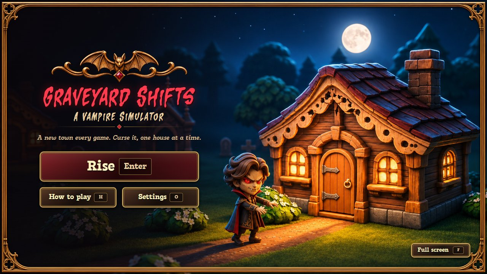
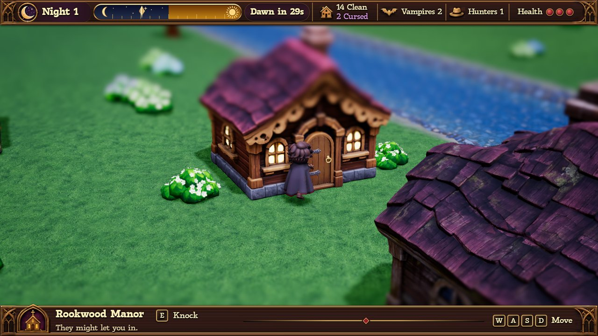
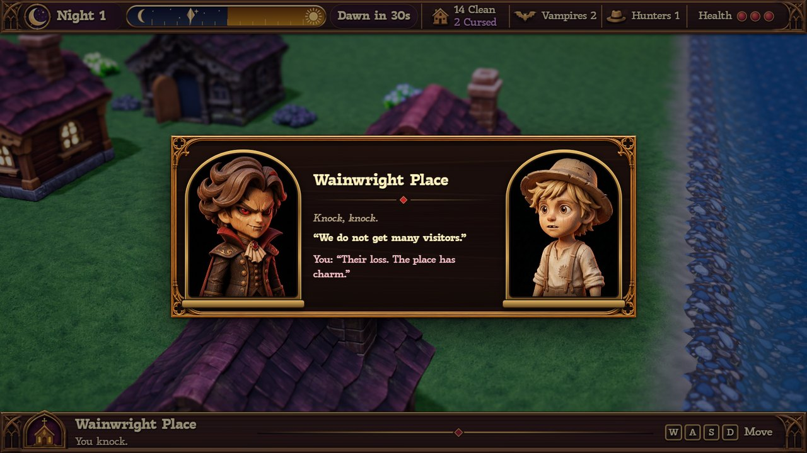
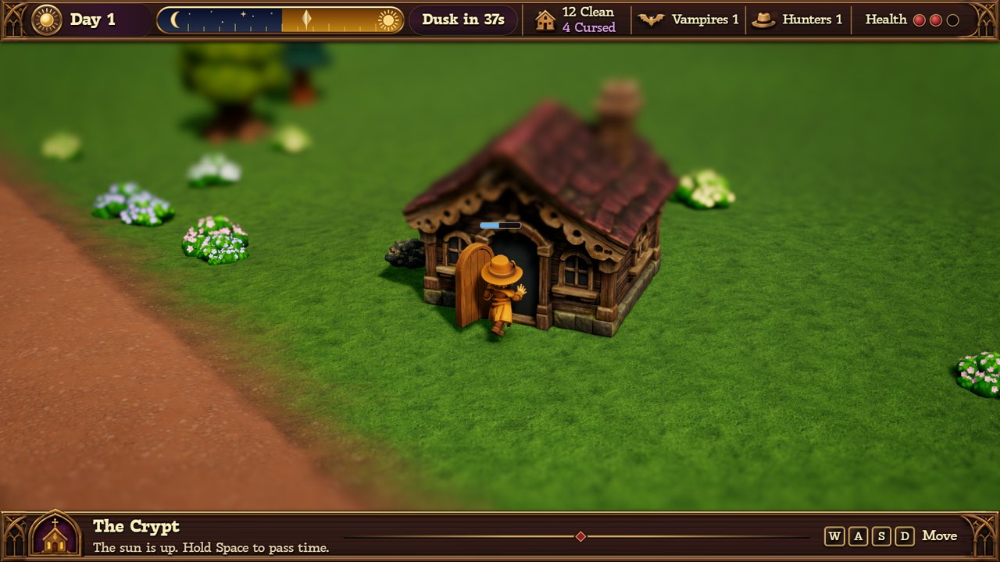

# Graveyard Shifts: A Vampire Simulator

A new town every game. Curse it, one house at a time.

You are a young vampire in a sleepy village. Each night, knock on doors and talk your way inside. Every house that invites you in is cursed, and every cursed house brings the town closer to being yours. Get back to shelter before the sun comes up, and watch out for the hunters.

Play it in the browser at https://mesolimbo.github.io/vampire-simulator/









## How to play

- **Feed:** walk up to a lit door at night and knock. If they invite you in, you feed and the house is cursed. Go three nights without feeding and you starve.
- **Curse the town:** a cursed house decays a little more each night. After three nights it raises a vampire of its own.
- **Hide by day:** sunlight kills. Before dawn, shelter in the crypt or in a cursed house.
- **Watch for hunters:** each morning the hunters visit houses and purge the cursed ones. The main hunter kills any vampire he finds.

| Key | Action |
| --- | --- |
| W A S D or arrows | Move |
| E | Knock or enter |
| Space (hold) | Hurry time |
| P | Pause |
| R | Restart |
| M | Mute |
| F | Full screen |
| H | How to play |
| Esc | Settings |

Drag to turn the view and use the mouse wheel to zoom.

Each game builds a new map. The console prints its seed, and adding `?seed=<number>` to the URL builds that map again.

## Running it locally

The game is plain HTML and JS with no build step. Three.js loads from a CDN. You need Python 3 to serve it, and Node.js for the syntax check.

```sh
make start    # check the scripts, then serve the game at http://127.0.0.1:8765/
make stop     # stop the server
make build    # check that every script parses
make zip      # package the game for itch.io
```

## Publishing

- **GitHub Pages:** the site is the `docs` folder. In the repository settings, deploy Pages from the `main` branch, folder `/docs`.
- **itch.io:** run `make zip`, then upload `dist/graveyard-shifts.zip` as an HTML game and tick "This file will be played in the browser". The zip leaves out the 3D asset preview and other files the game never loads, and the command fails if the game outgrows itch.io's size or file-count limits.

## Project layout

- `docs/`: the game itself, which is everything GitHub Pages and the itch.io zip serve.
  - `sim.js`: the rules, map generator and simulation state.
  - `render3d.js`: the Three.js renderer.
  - `render2d.js`: the flat 2D view (add `?view=2d` to the URL) and the doorstep conversation.
  - `ui.js`, `menu.js`, `audio.js`, `main.js`: the top and bottom bars, menus, sound, and input with the frame loop.
  - `scene3d.html`: a preview page for the 3D assets.
- `assets/`: Blender files and raw models, the sources for the art in `docs/assets`.
- `scripts/`: the dev server and the scripts that build art.
- `Design/`: concept notes and specs.
- `screenshots/`: the pictures in this README.
- `dist/`: where `make zip` writes `graveyard-shifts.zip`. Git ignores this folder, so it exists only after you run the command.
